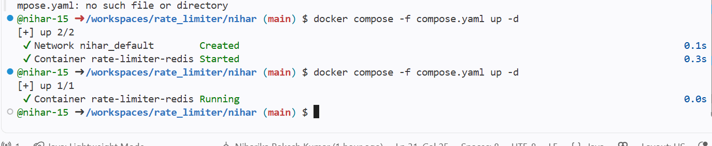
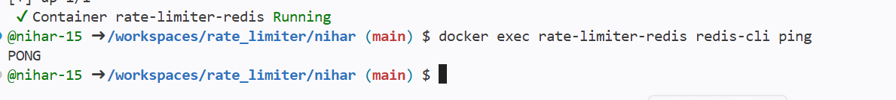
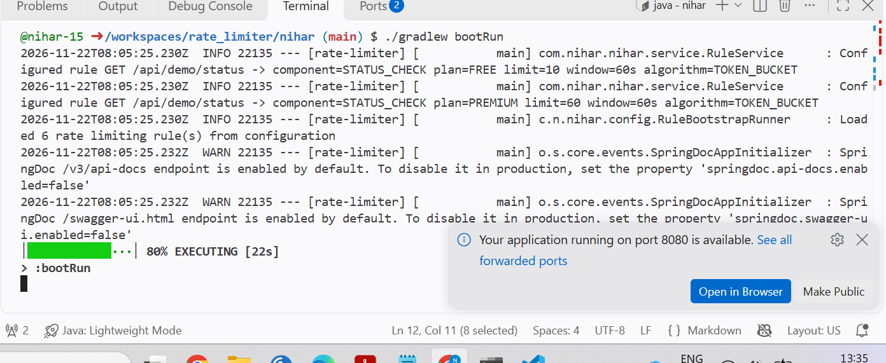
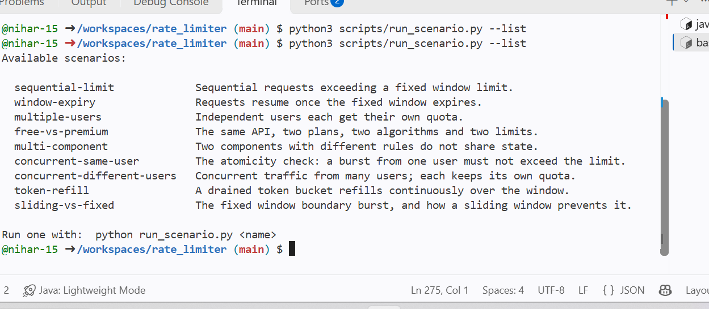
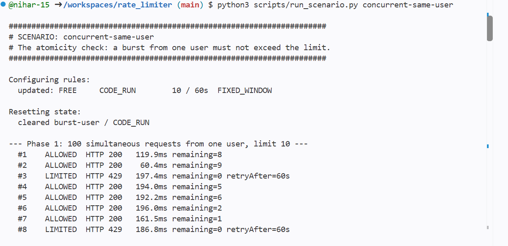
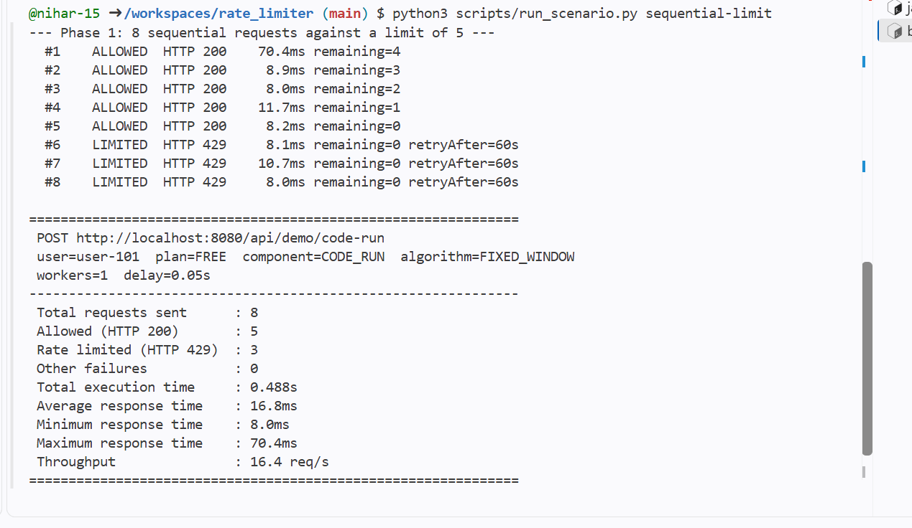
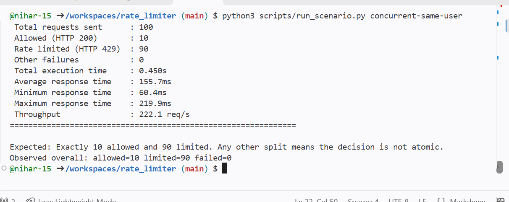
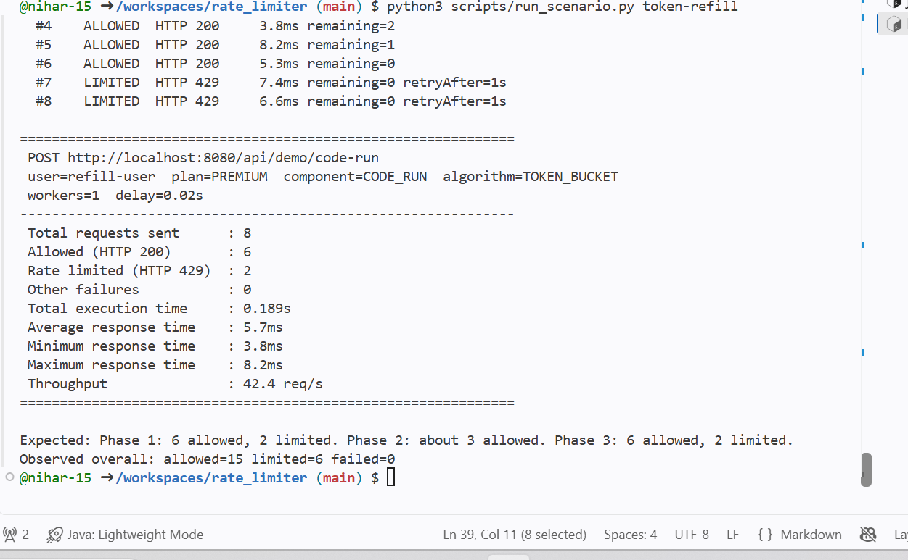
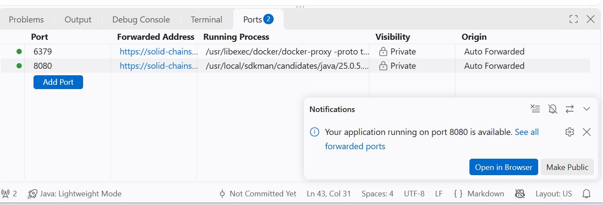

# rate_limiter

# Distributed Rate Limiter | Spring Boot, Redis & Lua

A configurable, Redis-backed rate limiter built with **Java 25, Spring Boot, Redis, and Lua scripting**.

This project demonstrates how rate limiting can be implemented in a distributed backend system using three algorithms: **Fixed Window, Sliding Window, and Token Bucket**.

It provides configurable rate-limiting rules, REST APIs for administration, Swagger UI for manual testing, and Python scripts for sequential and concurrent load testing.

The goal is to make the rate limiter easy to run, configure, experiment with, and understand.

---

## Key Features

- **Three rate-limiting algorithms:** Fixed Window, Sliding Window, and Token Bucket.
- **Redis-backed state management:** Maintains rate-limit state independently of application instances.
- **Atomic request evaluation:** Uses Redis Lua scripts to prevent race conditions during concurrent requests.
- **Runtime rule configuration:** Create, update, retrieve, and delete rate-limiting rules through REST APIs without restarting the application.
- **Plan-based rate limiting:** Apply different limits to FREE, PREMIUM, or custom subscription plans.
- **Component-based configuration:** Configure independent limits for different API endpoints.
- **Swagger UI:** Explore endpoints and manually execute requests.
- **State inspection and reset:** Inspect Redis-backed state and reset individual or all playground state.
- **Python load-testing utilities:** Run predefined scenarios and simulate concurrent traffic.
- **Automated tests:** Includes unit tests and Redis-backed integration tests.

---

## Technology Stack

| Technology | Purpose |
|---|---|
| Java 25 | Core programming language |
| Spring Boot | REST APIs and application framework |
| Redis | Distributed rate-limit state storage |
| Redis Lua | Atomic rate-limit evaluation |
| Gradle | Build and dependency management |
| Python 3.8+ | Load-testing scripts |
| Docker Compose | Redis setup |
| Swagger / OpenAPI | API documentation and manual testing |
| JUnit / Testcontainers | Automated and integration testing |

---

## 1. How It Works

Every incoming request is evaluated against a rate-limiting rule associated with its API endpoint and subscription plan.

For example:

A FREE user may be allowed 5 requests per minute, while a PREMIUM user may be allowed 20 requests per minute on the same endpoint.

The rate limiter determines whether the request should be allowed or rejected before the application proceeds with the demo operation.

### Request Processing Flow

```text
                 Incoming HTTP Request
                          |
                          |
                 X-User-Id / Plan
                          |
                          v
                   DemoController
                          |
                          v
                  RateLimitService
                          |
                          v
                    RuleManager
                          |
                 Resolve Applicable Rule
                  (Component + Plan)
                          |
                          v
                  RateLimitFactory
                          |
             Select Rate-Limit Algorithm
                          |
          +---------------+---------------+
          |               |               |
          v               v               v
      Fixed Window   Sliding Window   Token Bucket
          |               |               |
          +---------------+---------------+
                          |
                          v
                  Redis Lua Script
                          |
               Atomic Read / Evaluate /
                     Update State
                          |
                 +--------+--------+
                 |                 |
                 v                 v
             HTTP 200           HTTP 429
             Allowed            Rejected
```

### Why Redis Lua scripts?

A simple Redis GET followed by Java-side evaluation and SET can introduce race conditions.

For example, suppose a user has a limit of 5 requests and the current count is 4.

Two concurrent requests might both read the count as 4, both decide that the request is allowed, and both write back 5.

This can result in more requests being accepted than the configured limit.

This project solves that problem by executing the read, evaluation, and state update inside a single Redis Lua script.

Redis executes each script atomically, ensuring that concurrent requests cannot evaluate against the same outdated state.

---

## 2. Rate-Limiting Algorithms

The project implements three commonly used rate-limiting algorithms.

### A. Fixed Window Counter

Maintains a request counter for a fixed time interval.

**Example:** Limit of 5 requests per 60 seconds.

- First 5 requests are accepted.
- Subsequent requests are rejected.
- The counter resets when the window expires.

**Advantages**
- Simple implementation.
- Low memory overhead.
- Efficient for basic quotas.

**Limitation**

Requests can accumulate around window boundaries. For example, 5 requests at 59 seconds and another 5 at 61 seconds can result in 10 accepted requests within approximately 2 seconds.

### B. Sliding Window Log

Maintains timestamps of individual requests within the configured time window.

For every incoming request:

1. Remove timestamps older than the current window.
2. Count the remaining requests.
3. Reject the request if the limit has been reached.
4. Otherwise, record the new request timestamp.

**Advantages**
- More accurate request limiting.
- Avoids the fixed-window boundary burst problem.

**Limitation**
- Requires storing individual request timestamps.
- Higher memory consumption compared with Fixed Window.

### C. Token Bucket

Maintains a bucket of tokens that refill continuously over time.

Every incoming request consumes one token.

**Example:** Bucket capacity of 6 tokens, with a refill rate of 1 token per second.

- Initially, 6 requests can be accepted immediately.
- Once the bucket is empty, requests are rejected.
- As tokens refill, additional requests are accepted.

**Advantages**
- Supports controlled bursts.
- Provides a smooth long-term request rate.
- Useful for user-facing APIs.

### Algorithm Comparison

| Characteristic | Fixed Window | Sliding Window | Token Bucket |
|---|---|---|---|
| State | Counter and window start | Request timestamps | Available tokens and refill timestamp |
| Boundary burst | Possible | Prevented | Controlled by bucket capacity |
| Burst support | No explicit burst control | No | Yes |
| Memory usage | Low | Higher | Low |
| Best suited for | Basic quotas | Strict request limiting | APIs with controlled bursts |

---

## 3. Rule Configuration

A rate-limiting rule is identified by:

**Component + Subscription Plan**

Each component is associated with an HTTP method and API path.

For example:

```text
POST /api/demo/code-run
          |
          v
      CODE_RUN
          |
          +------ FREE
          |        Limit: 5 requests / 60 seconds
          |        Algorithm: FIXED_WINDOW
          |
          +------ PREMIUM
                   Limit: 20 requests / 60 seconds
                   Algorithm: TOKEN_BUCKET
```

### Rule Properties

| Property | Description |
|---|---|
| component | Logical identifier for the API component |
| httpMethod | HTTP method |
| apiPath | API endpoint path |
| plan | Subscription plan |
| limit | Maximum number of requests |
| windowInSeconds | Duration of the time window |
| algorithm | Selected rate-limiting algorithm |

### Default Rules

The application loads six demo rules at startup.

| Component | Endpoint | Plan | Limit | Window | Algorithm |
|---|---|---|---:|---:|---|
| CODE_RUN | POST /api/demo/code-run | FREE | 5 | 60s | FIXED_WINDOW |
| CODE_RUN | POST /api/demo/code-run | PREMIUM | 20 | 60s | TOKEN_BUCKET |
| CODE_SUBMIT | POST /api/demo/code-submit | FREE | 3 | 30s | SLIDING_WINDOW |
| CODE_SUBMIT | POST /api/demo/code-submit | PREMIUM | 15 | 30s | SLIDING_WINDOW |
| STATUS_CHECK | GET /api/demo/status | FREE | 10 | 60s | TOKEN_BUCKET |
| STATUS_CHECK | GET /api/demo/status | PREMIUM | 60 | 60s | TOKEN_BUCKET |

### Runtime Configuration

Rules can be created or updated through the administration APIs without restarting the application.

Example: Create a rule for a TRIAL subscription plan.

```bash
curl -X POST http://localhost:8080/api/admin/rules \
  -H "Content-Type: application/json" \
  -d '{
    "component": "CODE_RUN",
    "httpMethod": "POST",
    "apiPath": "/api/demo/code-run",
    "plan": "TRIAL",
    "limit": 2,
    "windowInSeconds": 30,
    "algorithm": "SLIDING_WINDOW"
  }'
```

The new rule applies to subsequent requests.

---

## 4. Redis State Management

The application maintains rate-limiting state in Redis.

Each user and component gets an independent Redis key.

```text
ratelimit:{userId}:{component}

Example:
ratelimit:user-101:CODE_RUN
```

The stored state contains the fields required by the three algorithms.

Example:

```json
{
  "userId": "user-101",
  "component": "CODE_RUN",
  "requestCount": 5,
  "windowStartTimestamp": 1795098552633,
  "requestTimestamps": [],
  "availableTokens": 17.018,
  "lastRefillTimestamp": 1795098564615
}
```

Redis keys have a TTL of two windows so inactive users' state expires automatically.

### State Inspection

The project provides APIs to inspect and reset rate-limiting state.

```text
GET    /api/admin/state/{userId}/{component}
DELETE /api/admin/state/{userId}/{component}
DELETE /api/admin/state
```

The state inspection APIs are enabled in the local profile.

---

## 5. API Reference

Swagger UI provides an interactive interface for exploring and testing the APIs.

**Swagger UI:** http://localhost:8080/swagger-ui/index.html

**OpenAPI JSON:** http://localhost:8080/v3/api-docs

### Rule Administration

| Method | Endpoint | Description |
|---|---|---|
| POST | /api/admin/rules | Create a rule |
| GET | /api/admin/rules | Retrieve all rules |
| GET | /api/admin/rules/{component} | Retrieve rules for a component |
| PUT | /api/admin/rules | Update a rule |
| DELETE | /api/admin/rules/{component} | Delete component rules |

### Demo Endpoints

| Method | Endpoint | Description |
|---|---|---|
| POST | /api/demo/code-run | Simulate code execution |
| POST | /api/demo/code-submit | Simulate code submission |
| GET | /api/demo/status | Check user status and remaining quotas |

### Request Headers

| Header | Description | Default |
|---|---|---|
| X-User-Id | Identifies the requesting user | anonymous |
| X-Subscription-Plan | Identifies the subscription plan | FREE |

Always provide a unique `X-User-Id` when testing multiple users.

### Example Responses

**Request allowed — HTTP 200**

```json
{
  "userId": "user-101",
  "component": "CODE_RUN",
  "algorithm": "FIXED_WINDOW",
  "allowed": true,
  "limit": 5,
  "windowInSeconds": 60,
  "message": "Request allowed",
  "plan": "FREE",
  "remaining": 4,
  "retryAfterSeconds": 0
}
```

**Request rejected — HTTP 429**

```json
{
  "userId": "user-101",
  "component": "CODE_RUN",
  "algorithm": "FIXED_WINDOW",
  "allowed": false,
  "limit": 5,
  "windowInSeconds": 60,
  "message": "Rate limit exceeded",
  "plan": "FREE",
  "remaining": 0,
  "retryAfterSeconds": 60
}
```

The demo APIs also return rate-limit headers:

```text
X-RateLimit-Limit
X-RateLimit-Remaining
X-RateLimit-Reset
Retry-After
```

---

## 6. Getting Started

### Prerequisites

| Requirement | Version |
|---|---|
| Java JDK | 25 |
| Docker | Required for Redis |
| Python | 3.8+ (for load testing) |

Gradle is managed through the included Gradle wrapper.

### Step 1: Clone the Repository

```bash
git clone https://github.com/nihar-15/rate_limiter.git
cd rate_limiter
```

### Step 2: Start Redis

```bash
docker compose -f nihar/compose.yaml up -d
```

Verify that Redis is running:

```bash
docker ps
docker exec rate-limiter-redis redis-cli ping
```

Expected output:

```text
PONG
```

### Step 3: Start the Spring Boot Application

Navigate to the application directory:

```bash
cd nihar
```

For macOS/Linux:

```bash
./gradlew bootRun
```

For Windows PowerShell:

```powershell
.\gradlew.bat bootRun
```

Wait for the Spring Boot application to start successfully.

The application runs on port `8080` by default and loads six rate-limiting rules.

### Step 4: Open Swagger UI

Navigate to:

http://localhost:8080/swagger-ui/index.html

You can now explore the APIs and execute requests manually.

---

## 7. Testing and Load Simulation

The project includes Python scripts to test rate-limiting behaviour against a running application.

No additional Python packages are required.

### A. Run Available Scenarios

From the repository root:

```bash
python3 scripts/run_scenario.py --list
```

Run an individual scenario:

```bash
python3 scripts/run_scenario.py sequential-limit
```

Run every predefined scenario:

```bash
python3 scripts/run_scenario.py --all
```

For Windows, use `python` instead of `python3`.

### B. Available Scenarios

| Scenario | What It Tests |
|---|---|
| sequential-limit | Requests exceeding the configured limit |
| window-expiry | Requests becoming available after window expiration |
| multiple-users | Independent quotas for different users |
| free-vs-premium | Different limits and algorithms for subscription plans |
| multi-component | Independent state for different API components |
| concurrent-same-user | Atomicity under concurrent requests |
| concurrent-different-users | Independent quotas under concurrent traffic |
| token-refill | Token Bucket refill behaviour |
| sliding-vs-fixed | Difference in window boundary behaviour |

### C. Generic Load Testing

The `load_test.py` script allows custom request volumes, delays, and worker counts.

Example:

```bash
python3 scripts/load_test.py \
  --url http://localhost:8080/api/demo/code-run \
  --user user-101 \
  --plan FREE \
  --requests 20 \
  --delay 0.1
```

For concurrent requests:

```bash
python3 scripts/load_test.py \
  --url http://localhost:8080/api/demo/code-run \
  --user user-101 \
  --plan FREE \
  --requests 100 \
  --workers 25
```

The script reports:

- Total requests sent
- Allowed requests (HTTP 200)
- Rate-limited requests (HTTP 429)
- Other failures
- Average, minimum, and maximum response times
- Total execution time
- Throughput

---

## 8. Manual Verification Using Swagger

You can also verify the behaviour directly from Swagger without running Python scripts.

1. Open Swagger UI.
2. Locate the demo endpoint `POST /api/demo/code-run`.
3. Provide the `X-User-Id` and `X-Subscription-Plan` headers.
4. Execute the endpoint repeatedly.
5. Observe the HTTP response and remaining request count.
6. Once the configured limit is reached, subsequent requests should return HTTP 429.
7. Inspect the corresponding Redis state through the administration API.

For the default FREE rule, the first five requests should be allowed within the 60-second window, while subsequent requests should be rejected until the window resets.

---

## 9. Automated Tests

The project includes unit tests and Redis-backed integration tests.

Run all tests from the `nihar` directory:

```bash
./gradlew test
```

On Windows:

```powershell
.\gradlew.bat test
```

Run the complete build:

```bash
./gradlew clean build
```

Integration tests use Testcontainers and require Docker to be running.

### Test Coverage

The existing test suite contains **157 tests with 0 failures**.

| Area | Coverage |
|---|---|
| Algorithm tests | Fixed Window, Sliding Window, Token Bucket |
| Factory tests | Algorithm selection |
| Manager tests | Rule resolution and Redis state management |
| Service tests | Rule configuration and rate-limit evaluation |
| Controller tests | API validation, responses, and status codes |
| Integration tests | Redis persistence, Lua execution, TTL, and concurrency |
| API integration tests | End-to-end HTTP behaviour and concurrent requests |

### Concurrency Verification

One of the most important tests verifies that concurrent requests cannot exceed the configured limit.

Example:

```text
Scenario: 100 simultaneous requests from one user
Configured limit: 10

Total requests sent       : 100
Allowed (HTTP 200)        : 10
Rate limited (HTTP 429)   : 90
```

This demonstrates the atomic request-evaluation behaviour implemented using Redis Lua scripts.

---

## 10. Execution Evidence

The following screenshots demonstrate the application setup, runtime behaviour, and testing workflow.

> Replace the image placeholders below with your actual screenshots. Keep the screenshots in a folder such as `docs/images/` in the repository.

### 1. Redis Startup

Shows Redis starting successfully through Docker Compose and the Redis health check returning `PONG`.


### 2. Spring Boot Application Startup

Shows the Spring Boot application starting successfully and loading the configured rate-limiting rules.


### 3. Swagger UI

Shows the available APIs and the interactive Swagger interface used for manual testing.


### 4. Successful and Rate-Limited Requests

Demonstrates the transition from HTTP 200 to HTTP 429 after the configured request limit is reached.


### 5. Redis State Inspection

Shows the state maintained for a user and component in Redis.


### 6. Sequential Load Testing

Shows the Python load-testing script executing sequential requests and reporting allowed and rejected requests.


### 7. Concurrent Load Testing

Demonstrates that the configured limit is respected under concurrent traffic.


---

## 11. Project Structure

```text
rate_limiter/
│
├── nihar/
│   ├── src/
│   │   ├── main/
│   │   │   ├── java/com/nihar/nihar/
│   │   │   │   ├── algorithm/
│   │   │   │   ├── config/
│   │   │   │   ├── entity/
│   │   │   │   ├── enums/
│   │   │   │   ├── interfaces/
│   │   │   │   ├── managers/
│   │   │   │   ├── model/
│   │   │   │   ├── service/
│   │   │   │   └── web/
│   │   │   └── resources/
│   │   │       └── scripts/
│   │   │           ├── fixed_window.lua
│   │   │           ├── sliding_window.lua
│   │   │           └── token_bucket.lua
│   │   └── test/
│   │
│   ├── compose.yaml
│   └── build.gradle
│
├── scripts/
│   ├── load_test.py
│   ├── run_scenario.py
│   ├── scenarios.json
│   └── examples/
│
└── README.md
```

### Important Packages

| Package | Responsibility |
|---|---|
| algorithm | Implementations of the three rate-limiting algorithms |
| interfaces | Common algorithm abstraction and template method |
| managers | Rule management, Redis state, and algorithm factory |
| entity | Core domain objects |
| model | Rate-limit decisions and verdicts |
| service | Business logic and orchestration |
| web | REST controllers, DTOs, and exception handling |
| config | Application configuration and rule initialization |

---

## 12. Security and Configuration

The project uses different security configurations depending on the active Spring profile.

**Local profile**

- Demo endpoints are publicly accessible.
- Swagger UI is accessible.
- Administration APIs are available for playground testing.
- State inspection is enabled.

**Non-local profiles**

- Demo endpoints remain public.
- Administration APIs and Swagger require HTTP Basic authentication.
- State inspection and reset-all are disabled unless explicitly enabled.

For example:

```bash
./gradlew bootRun --args="--spring.profiles.active=prod"
```

---

## 13. Future Enhancements

Potential improvements for taking the project closer to production readiness:

1. Add Micrometer metrics for allowed and rejected requests.
2. Integrate Prometheus and Grafana dashboards.
3. Persist rate-limiting rules in a database.
4. Add per-IP and global rate-limiting strategies.
5. Support dynamic API path patterns.
6. Add a configurable Redis failure policy.
7. Introduce a dedicated administration dashboard.
8. Extend the implementation with additional algorithms such as Leaky Bucket and Sliding Window Counter.

---

## Key Engineering Concepts Demonstrated

This project explores several important backend engineering concepts:

- Distributed state management using Redis.
- Atomic execution using Redis Lua scripts.
- Race conditions and concurrency control.
- Algorithm design and trade-offs.
- REST API design and runtime configuration.
- Subscription-based access control.
- Integration testing with Testcontainers.
- Load testing and performance observation.

---

## Repository

**GitHub:** https://github.com/nihar-15/rate_limiter


Starter redis


Verify redis running 



Start your Spring Boot application



Run your testing scripts


Test 1 : python3 scripts/run_scenario.py sequential-limit 



Test 2 : python3 scripts/run_scenario.py concurrent-same-user



Test 3 : python3 scripts/run_scenario.py multiple-users


Test 4: python3 scripts/run_scenario.py token-refill




Testing all sceanrios at once 
python3 scripts/run_scenario.py --all


Ports running in the application 



Swagger Up and api
