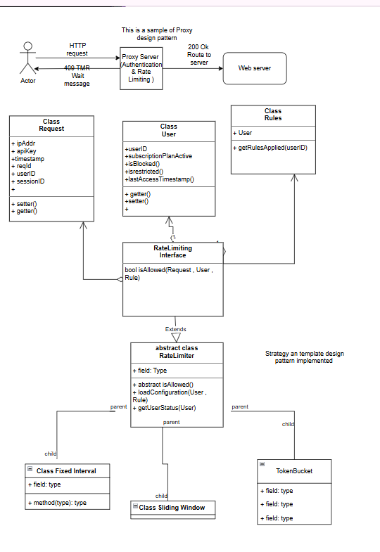
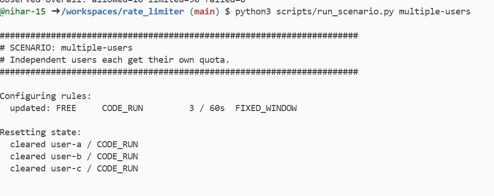
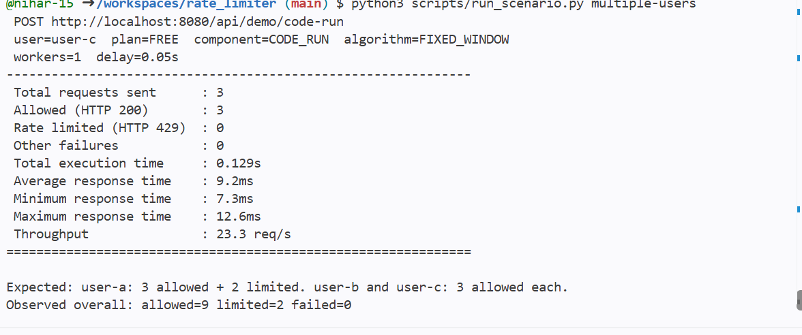
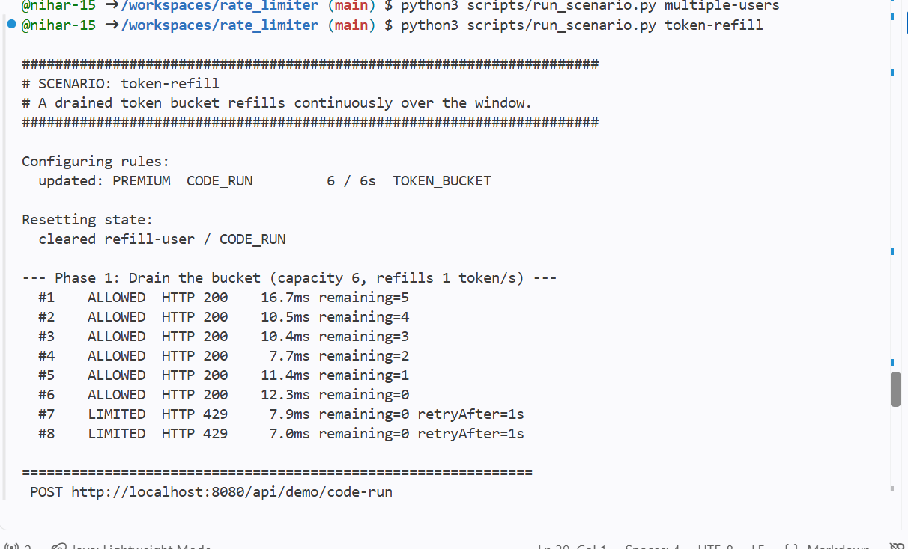
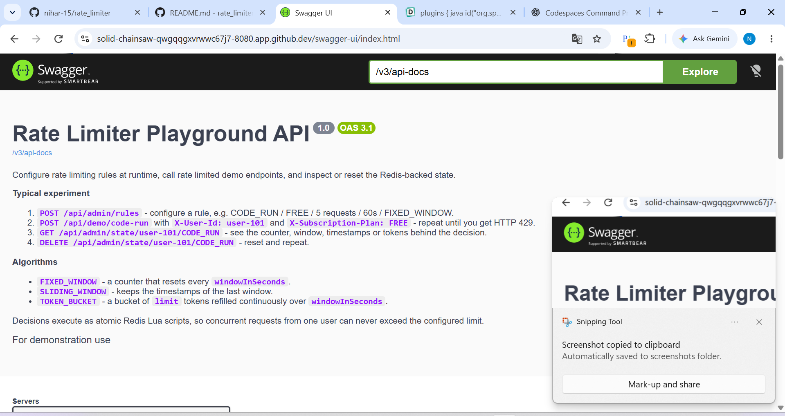

# rate_limiter

LLD 

Starter redis

Verify redis running 

Start your Spring Boot application

Run your testing scripts

Test 1 : python3 scripts/run_scenario.py sequential-limit 

Test 2 : python3 scripts/run_scenario.py concurrent-same-user

Test 3 : python3 scripts/run_scenario.py multiple-users

Test 4: python3 scripts/run_scenario.py token-refill

Testing all sceanrios at once 
python3 scripts/run_scenario.py --all

Ports running in the application 

Swagger Up and api
